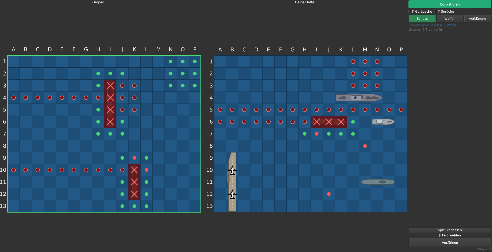

# SpeedyShips – Schiffe versenken im Browser

**[▶ Jetzt spielen](https://kryptomane.github.io/2026_Web_Ships/)** – ohne Installation, direkt im Browser.

Klassisches Schiffe versenken auf einem 16 × 13 Felder großen Meer, mit ein paar Extras:
Raketen, Torpedos, Harpoon-Raketen und Flugzeuge vom Träger, Aufklärung per Sonar und Flugzeug,
Flak gegen feindliche Flieger – und auf Wunsch Täuschkörper und Nebelbänke.

## Spielen

- **Allein:** *Einzelspieler* wählen und gegen den Computer antreten (leicht, mittel oder schwer).
- **Zu zweit über das Internet:**
  1. Spieler 1 klickt **Raum eröffnen** und schickt den angezeigten Code an Spieler 2.
  2. Spieler 2 gibt den Code ein und klickt **Beitreten**.
  3. Spieler 1 richtet die Partie ein, beide setzen ihre Schiffe – los geht's.

Bricht die Verbindung ab, lässt sich die Partie fortsetzen, sobald beide wieder da sind.
Die Webversion spielt auch mit den Apps für Windows und Android zusammen.

## Was die Markierungen bedeuten

| Zeichen | Bedeutung |
|---|---|
| roter Punkt | Schuss ins Wasser |
| dunkelroter Punkt | Waffe (Rakete, Torpedo, Harpoon) ins Wasser |
| rotes Kreuz | Treffer |
| grüner Punkt | aufgeklärt: hier ist nichts |
| oranger Rahmen | aufgeklärt: hier ist etwas |

## Gut zu wissen

- **Werbeblocker** (z. B. uBlock Origin) können die Verbindung zum Spielserver sperren.
  Dann für diese Seite deaktivieren.
- Der Spielserver läuft privat und ist nicht immer an. Ist er aus, geht nur der Einzelspieler-Modus.
- Die Webversion ist ohne Ton.
- Beim Spiel über den Server werden Spielername, Gerät, Browser, IP-Adresse sowie Beginn und Ende
  der Partie protokolliert.

## Lizenz

© 2026 Silas Maile. Alle Rechte vorbehalten – Details in [LIZENZ.txt](LIZENZ.txt).
Dieses Repository enthält nur die fertig gebaute Webversion, keinen Quellcode.
